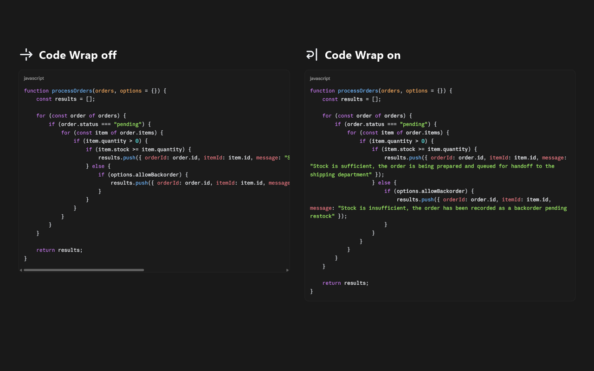
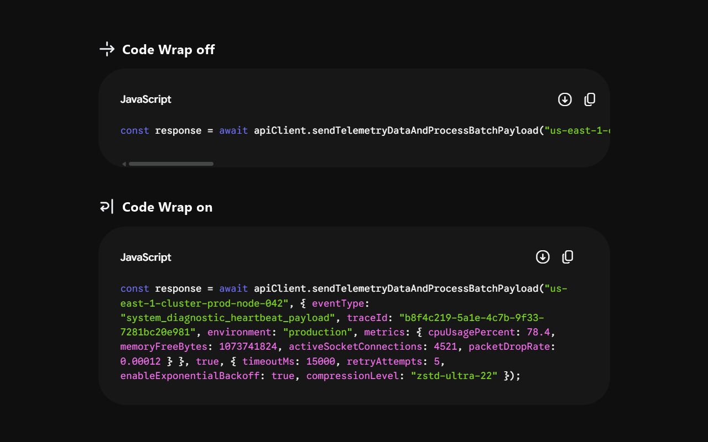

# Code Wrap

Wrap long lines in classic code blocks on AI chat sites with one toolbar button.
Code Wrap preserves the original code and syntax highlighting.

Current integrations include **Claude**, **Google Gemini**, and **ChatGPT**.
The initial release targets **Google Chrome**.

## Examples





## Install locally

1. Open `chrome://extensions` in Google Chrome.
2. Enable **Developer mode**.
3. Select **Load unpacked** and choose this folder (the one containing
   `manifest.json`).
4. Refresh any supported pages that were already open when you installed or
   reloaded the extension. New pages are handled automatically.
5. Pin Code Wrap to the toolbar if you want quick access to its switch.

There is no build step and no package installation.

## Use

Code Wrap is on by default. Click its toolbar icon to toggle wrapping across
supported sites and all their open tabs. A bent return arrow means
wrapping is on; a straight right arrow means it is off. Hover over the icon to
see the current state and what clicking will do. Your choice is saved locally
and survives a browser restart.
A **!** badge means the setting could not be updated; click again to retry.

Both toolbar icons use a light arrow with a dark outline for visibility on light
and dark backgrounds. SVG sources and PNGs at 16, 32, 48, and 128 pixels are
included in `icons/`.

When Code Wrap is off, each site uses its own display settings, including any
built-in word-wrap preference.

Code Wrap targets classic response code blocks. Paragraphs, inline code, tables,
and interactive editors keep their original layout.

## Privacy and implementation

- The current release applies its stylesheet and settings controller to
  `https://claude.ai/*`, `https://gemini.google.com/*`, and
  `https://chatgpt.com/*` in the top-level document.
- Uses `storage` to save the global wrapping setting locally in your browser.
- Does not read, rewrite, save, or transmit conversation text.
- Does not intercept copy actions, rewrite code, or add newline characters.
- Uses site-specific CSS and a small settings controller. No polling, DOM
  observer, external dependencies, analytics, server, or network requests.

Wrapping is visual: long tokens can break across display lines, and code blocks
become taller. The source text remains unchanged. Native copy controls and manual
selection still need verification when a site's renderer changes.

See the [privacy policy](PRIVACY.md) for details.

## Validation

Wrapping and the toolbar toggle have been checked in Chrome on the current
integrations.

Run the dependency-free controller tests and syntax checks with Node.js:

```sh
node --test tests/controllers.test.cjs
node --check background.js
node --check content.js
```

For a live check, use disposable new chats containing a long JavaScript call,
a long URL, single-line JSON, indented code, inline code, a paragraph, and a table.
Verify wrapping during streaming, original copy output, unchanged excluded areas,
and restoration when disabled. Also check navigation, refresh, multiple tabs,
narrow windows, and browser restart. A disappearing scrollbar alone does not
prove that text remains visible.
